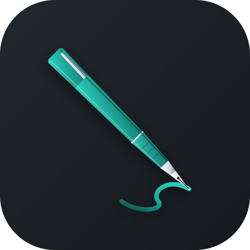
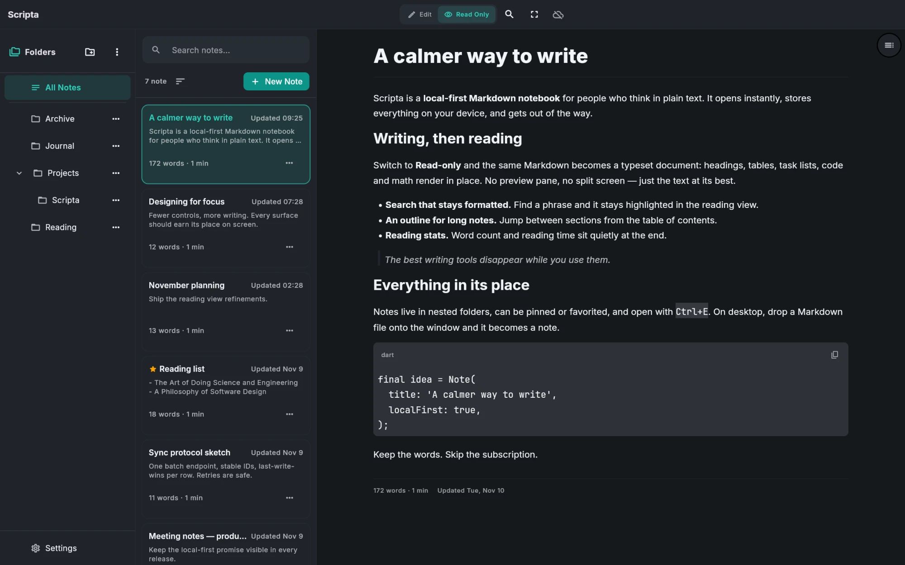
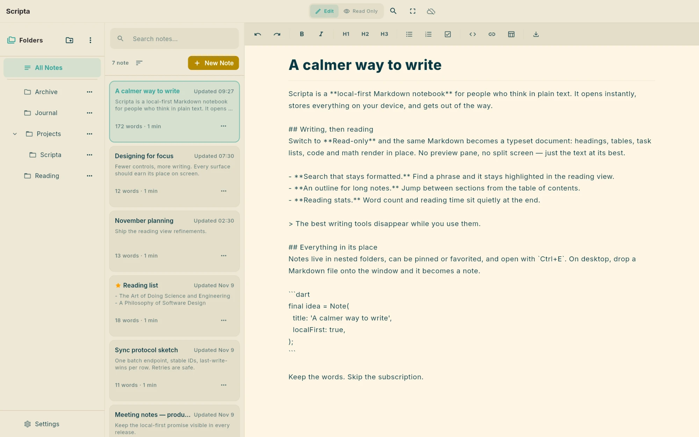
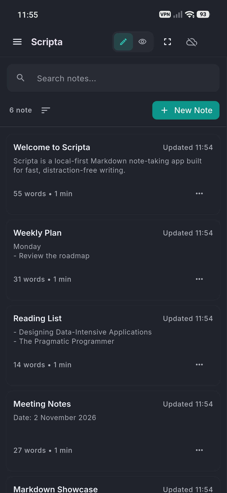
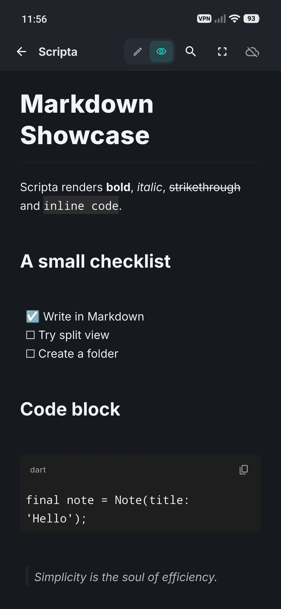
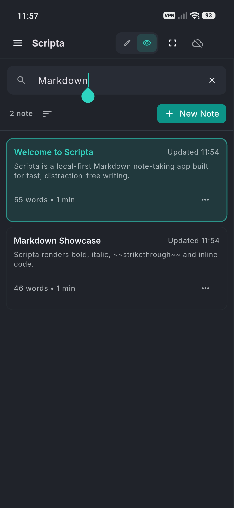
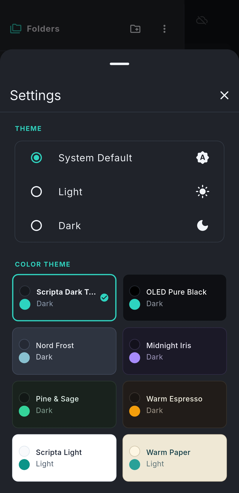

<div align="center">

  

  <h1>Scripta</h1>

  <p><strong>A calmer place for your notes.</strong><br />
  Local-first Markdown writing for Android, iOS, Linux, Windows and macOS.</p>

  <p>
    <a href="https://github.com/rizzonicola/Scripta/releases/latest"></a>
    <a href="https://flutter.dev"></a>
    <a href="#-supported-platforms"></a>
    <a href="LICENSE"></a>
  </p>

</div>

---

**Scripta** is an open-source Markdown notebook built for people who want their writing to feel immediate and stay theirs. Notes open instantly, save locally, and remain fully available offline. There is no account, no feed, no telemetry — and synchronization is optional, self-hosted, and entirely under your control.

Write in clean Markdown on any screen, then switch to a beautifully typeset reading view when it is time to review, study, or simply enjoy what you wrote.

---

## 📸 Screenshots

<p align="center">
  <a href="assets/readme/desktop-reading.webp"></a>
  <a href="assets/readme/desktop-editor.webp"></a>
</p>

<p align="center"><sub>Desktop: the formatted reading view and the Markdown editor.</sub></p>

<p align="center">
  <a href="fastlane/metadata/android/en-US/images/phoneScreenshots/1.png"></a>
  <a href="fastlane/metadata/android/en-US/images/phoneScreenshots/3.png"></a>
  <a href="fastlane/metadata/android/en-US/images/phoneScreenshots/4.png"></a>
  <a href="fastlane/metadata/android/en-US/images/phoneScreenshots/6.png"></a>
</p>

<p align="center"><sub>Android: your notes, the reading view, instant search and eight color themes.</sub></p>

---

## ✨ Why Scripta

- **Your words, your device.** Everything is stored locally in SQLite and works offline. No account is required, and there is no analytics, advertising or Google Play Services.
- **Markdown without the friction.** A focused editor with a smart toolbar, formatting shortcuts and a rendered reading view that makes long notes a pleasure to revisit.
- **One app, every screen.** A three-pane desktop workspace, a comfortable tablet layout and a single-pane mobile experience — all from the same native Flutter codebase.
- **Sync only if you want it.** Connect Scripta to your own [self-hosted server](https://github.com/rizzonicola/Scripta-backend) for multi-device sync. No hosted service, no lock-in.

---

## 🖋️ Writing and reading

- **Markdown-first editor** with a smart toolbar, undo history and `Ctrl`/`Cmd` formatting shortcuts.
- **Two modes, one note.** Edit the source or switch to **Read-only** and see headings, lists, tables, task lists, quotes, code and math rendered in place.
- **A reading view made for long notes.** Formatted search highlighting, a section outline when space allows, word count, reading time and keyboard paging (`PageUp`/`PageDown`, `Home`/`End`, `Space`).
- **Focus mode** strips away the interface for distraction-free writing or reading — including the floating outline button.
- **Typography that fits you.** Eight color themes, adjustable font family, size and line height, and a carefully tuned typeset reading column.
- **LaTeX support.** Inline and display math render natively, with a readable fallback if a formula cannot be parsed.

## 🗂️ Organizing and finding

- **Nested folders, favorites and pinned notes**, with drag-and-drop organization and per-view sorting.
- **Instant local search** across titles and content, with highlighted matches that stay formatted in the reading view.
- **Desktop-class workflow:** right-click menus for notes, folders, empty areas and *All notes*, plus a full keyboard shortcut set (`F1` shows the list).
- **Open files and folders natively** on Linux, Windows and macOS, or drag Markdown files and folders onto the window to import them.
- **Backups without lock-in.** Export a complete ZIP archive or plain Markdown files at any time.

## 🔄 Optional self-hosted sync

Synchronization is deliberately separate from the local experience: the app never waits for the network. When you connect it to the **notes-server** backend, changes are exchanged asynchronously and resolved with last-write-wins semantics per note.

- Backend source and Docker setup: [github.com/rizzonicola/Scripta-backend](https://github.com/rizzonicola/Scripta-backend)
- The server is free software too, released under **GPLv3**.
- Sync can run on launch, on note switch, on app lifecycle changes or after a configurable period of inactivity.
- Authentication tokens are kept in the platform's secure storage.

---

## 💻 Supported platforms

| Platform | Packages | Status |
|:---|:---|:---:|
| **Android** | Universal APK and split APKs | ✅ Supported |
| **Linux** | x64 tarball and Flatpak bundle | ✅ Supported |
| **Windows** | x64 and ARM64 installers | ✅ Supported |
| **macOS** | Universal DMG (Intel and Apple Silicon) | ✅ Supported |
| **iOS** | Unsigned IPA for sideloading | ✅ Supported |

> **Android / F-Droid:** F-Droid inclusion is in progress. Until the listing is available, download the APK directly from [Releases](https://github.com/rizzonicola/Scripta/releases/latest).

---

## 🚀 Download and install

Download the latest build for your platform from the [Releases page](https://github.com/rizzonicola/Scripta/releases/latest).

- **Android** — install the universal APK, or pick the split APK that matches your device architecture.
- **Linux** — extract the tarball and run `./Scripta-linux-x64/scripta`, or install the Flatpak bundle with `flatpak install Scripta.flatpak`.
- **Windows** — run the installer for your architecture (x64 or ARM64).
- **macOS** — open the universal DMG and drag Scripta into Applications.
- **iOS** — sideload the unsigned IPA with your preferred tool.

### Build from source

> **Toolchain:** Flutter 3.44+ with Dart 3.12+. On NixOS, `nix develop` provides the pinned Flutter 3.44.4 environment.

```bash
git clone https://github.com/rizzonicola/Scripta.git
cd Scripta

flutter pub get
flutter run        # or: flutter run -d linux / windows / macos / <device-id>
```

Before opening a pull request, run:

```bash
flutter analyze
flutter test
```

---

## ⌨️ Keyboard shortcuts

Available on Linux, Windows and macOS. On macOS, use `Cmd` instead of `Ctrl`.

| Action | Shortcut |
|:---|:---|
| New note / new folder | `Ctrl+N` / `Ctrl+Shift+N` |
| Save and sync now | `Ctrl+S` |
| Search notes / find in note | `Ctrl+Shift+F` / `Ctrl+F` |
| Toggle Edit ↔ Read-only | `Ctrl+E` |
| Focus mode / exit | `Ctrl+Shift+Enter` / `Esc` |
| Pin / move / duplicate / export / delete note | `Ctrl+Shift+P` / `M` / `D` / `E` / `Del` |
| Next / previous note | `Ctrl+PageDown` / `Ctrl+PageUp` |
| Bold / italic / link / heading 1–3 | `Ctrl+B` / `I` / `K` / `1`–`3` |
| Settings / shortcut list | `Ctrl+,` / `F1` |
| System fullscreen | `F11` |

Right-click a note, a folder (or use its `...` button), *All notes*, or any empty area of the sidebar or note list to open the matching context menu.

---

## 🧱 Built with

- [Flutter](https://flutter.dev) with [Riverpod](https://riverpod.dev) for the interface and state.
- SQLite (WAL mode) for fast, reliable local storage.
- [flutter_md](https://pub.dev/packages/flutter_md) and [flutter_math_fork](https://pub.dev/packages/flutter_math_fork) for Markdown and LaTeX rendering.
- [Inter](https://rsms.me/inter/) and [JetBrains Mono](https://www.jetbrains.com/lp/mono/), both licensed under the SIL Open Font License.

---

## 🤝 Contributing

Bug reports, feature ideas and pull requests are welcome. For larger changes, please open an issue first so the direction can be discussed before implementation.

- [Open an issue](https://github.com/rizzonicola/Scripta/issues)
- [Browse the source](https://github.com/rizzonicola/Scripta)
- Run `flutter analyze` and `flutter test` before submitting a PR.

---

## 📄 License

Scripta is free and open-source software released under the [GNU General Public License v3.0](LICENSE).
